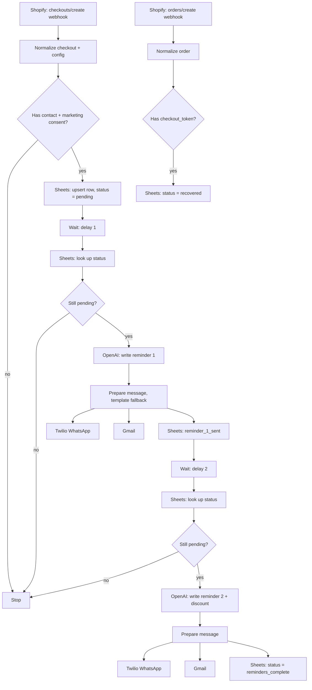
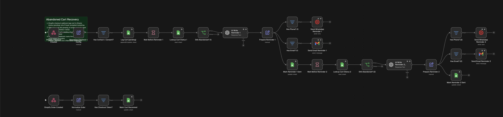
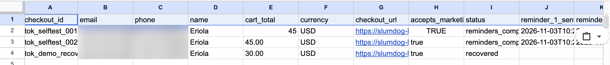
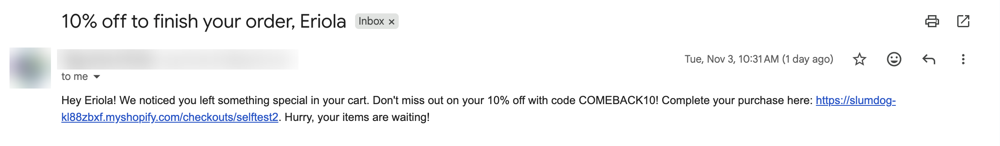

# Slumdog · n8n Abandoned Cart Recovery

> 🎥 **Loom demo (60–90s):** _LOOM_LINK_HERE_

Recover lost Shopify sales automatically. When a shopper starts checkout and leaves, this n8n workflow logs the cart, waits, and sends two AI-written reminders by **WhatsApp** and **email**. The second reminder carries a **discount code**. If the shopper buys at any point, the reminders stop.

---

## Problem

Most online shoppers who start a checkout never finish it. Small Shopify stores rarely follow up, or they rely on Shopify's single generic email, which ignores WhatsApp, the channel many customers actually read.

## Who it's for

- Small and medium Shopify stores, especially in markets where WhatsApp is the main messaging channel
- Agencies and freelancers who run retention automations for e-commerce clients

## Features

- **Shopify webhook trigger:** `checkouts/create` starts the flow the moment a checkout begins
- **Timed reminders:** reminder 1 after delay 1, reminder 2 after delay 2. The delays are configurable (2 and 3 minutes for the demo, 1 hour and 24 hours in production).
- **Discount code:** reminder 2 includes `COMEBACK10` (10% off)
- **AI-personalised copy:** OpenAI writes each message using the customer's name, cart total and checkout link. A fixed template is used if the AI call fails.
- **Two channels:** WhatsApp through Twilio, and email through Gmail. Each channel is skipped when that contact detail is missing. See [Known limitation](#known-limitation-whatsapp-on-free-trials) for WhatsApp on the free trial. Each channel is skipped when that contact detail is missing.
- **Stops on purchase:** the `orders/create` webhook marks the cart `recovered`, and every reminder step re-checks the status before sending
- **Consent gate:** messages go only to buyers with `buyer_accepts_marketing = true`
- **Google Sheets log:** one row per checkout, showing its status and when each reminder was sent

## Stack

| Layer | Tool |
|---|---|
| Orchestration | n8n (Cloud; works the same self-hosted) |
| Trigger source | Shopify webhooks (development store) |
| AI | OpenAI `gpt-4o-mini` through the n8n OpenAI node (n8n AI credits) |
| WhatsApp | Twilio (free trial) |
| Email | Gmail |
| Storage / log | Google Sheets |

## Tools used (free tiers)

Everything runs on free plans, trials or test modes, as the internship allows. Substitutions from the brief's stack:

| Brief says | Used here | Why |
|---|---|---|
| n8n (self-hosted) | n8n Cloud trial | Gives Shopify a public HTTPS webhook URL with no server setup. The exported workflow imports unchanged into self-hosted n8n Community Edition. |
| OpenAI/Claude | OpenAI `gpt-4o-mini` through n8n's built-in AI credits | No paid API key needed. The model is set in the two AI nodes (and `OPENAI_MODEL`) and can be switched to Claude, Gemini or Groq. |
| WhatsApp | Twilio free trial | Built and wired; delivery is limited by the trial (see below). |
| Shopify store | Shopify Partners development store | Free; real `checkouts/create` and `orders/create` webhooks. |

## Architecture



The checkout `token` is the shared key: Shopify sends it as `token` on checkouts and as `checkout_token` on orders.

## Known limitation: WhatsApp on free trials

The WhatsApp steps are built, connected to Twilio and tested, but **Twilio's free trial does not deliver them**. Trial accounts may only send Twilio's own pre-made WhatsApp templates. Any custom text, AI-written or fixed, is rejected with error `21654 ContentSid Required`, and the Content API that lists templates is also blocked on trial (`20003`).

What this means in the recorded run:
- The WhatsApp step runs, retries 3 times, then fails gracefully (`continueRegularOutput`), so the email reminder and the sheet update still happen, which is exactly the error handling the flow is designed for.
- Email reminders are delivered with AI-written, personalised copy.

To enable WhatsApp, either upgrade the Twilio account (no code change), or swap the two Twilio nodes for n8n's **WhatsApp Business Cloud** node using Meta's free test number (same inputs: `phone` and `message`). The Meta developer sign-up could not be completed in time for this submission.

## Error handling

| Case | Behaviour |
|---|---|
| Google Sheets / Gmail / Twilio API failures | `retryOnFail`, up to 3 attempts with 2–3 seconds between tries |
| One channel fails (e.g. WhatsApp) | `continueRegularOutput`, so the other channel and the status update still run |
| AI call fails or returns empty text | A template message is used instead, and `ai_fallback_used = true` |
| Webhook missing email and phone, or no consent | Filtered out; nothing is logged or sent |
| Order with no `checkout_token` (e.g. POS or draft order) | Filtered out |
| Cart bought between reminders | The status check stops the flow before sending |
| Two checkouts arrive at the same moment | Logged with Google Sheets' atomic append (`useAppend`), so rows never overwrite each other (found and fixed during testing) |

## Setup

1. **Import the workflow:** in n8n, go to *Workflows*, then *Import from file*, and choose `workflow/abandoned-cart-recovery.json`.
2. **Google Sheet:** create a sheet named `Slumdog Cart Recovery` whose `Sheet1` tab has these headers:
   `checkout_id, email, phone, name, cart_total, currency, checkout_url, accepts_marketing, status, reminder_1_sent, reminder_2_sent, created_at, updated_at`
   (see `sample-data/sheet-template.csv`). Select it in every Google Sheets node.
3. **Credentials in n8n:**
   - Google Sheets OAuth2 and Gmail OAuth2
   - OpenAI API key (or n8n AI credits)
   - Twilio: Account SID and Auth Token
4. **Twilio WhatsApp:** connect each test phone to Twilio's WhatsApp testing environment (*Try out WhatsApp* in the Twilio Console). Free-text WhatsApp needs an upgraded Twilio account; see the known limitation below.
5. **Config:** edit the **Normalize Checkout + Config** node to set the store name, discount code and percent, both delays, and the Twilio WhatsApp sender.
6. **Shopify:** create the discount `COMEBACK10`. Then in *Settings*, go to *Notifications*, then *Webhooks*, and add:
   - `Checkout creation` → `https://<your-n8n>/webhook/shopify/checkout-created` (JSON)
   - `Order creation` → `https://<your-n8n>/webhook/shopify/order-created` (JSON)
7. **Activate** the workflow.

All variables are listed in [`.env.example`](.env.example).

### Test without Shopify

```bash
N8N_BASE_URL=https://your-instance.app.n8n.cloud ./scripts/send-test-events.sh checkout
# wait, or let reminder 1 fire, then simulate a purchase:
N8N_BASE_URL=https://your-instance.app.n8n.cloud ./scripts/send-test-events.sh order
```

## Screenshots

**Workflow**



**Sheet log** (one row per checkout; the last row was bought before reminder 1, so it is `recovered` and got no reminders)



**Reminder 2 email** (AI-written, includes the discount code)



Personal contact details in the screenshots are blurred.

## Testing

See [`docs/TEST_CHECKLIST.md`](docs/TEST_CHECKLIST.md) and the recorded run in `docs/recorded-run/`.

## Data and safety

- Seed data only: all sample customers in `sample-data/` are fictional
- No keys or secrets are committed; credentials live in n8n's credential store
- Messages go only to buyers who opted in, and in the demo only to the developer's own test email and phone

## Repo structure

```
workflow/abandoned-cart-recovery.json   exported n8n workflow
sample-data/                            fake Shopify payloads + sheet template
scripts/send-test-events.sh             fire test webhooks
docs/TEST_CHECKLIST.md                  test checklist for the main flow
docs/recorded-run/                      execution export / screenshots of a run
.env.example                            every variable used
```
